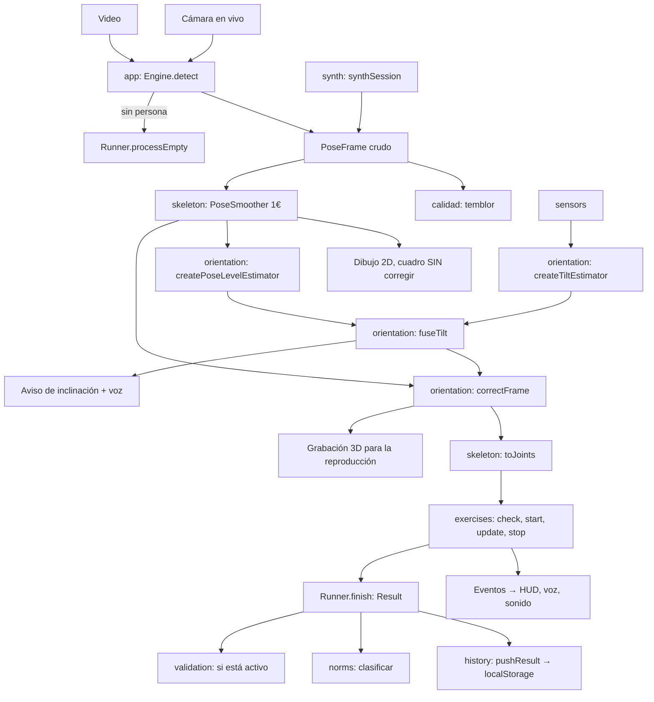

# FitGram — Arquitectura

Estructura del documento tomada de la arquitectura de v1 de Jose (`docs/jose-v1/ARQUITECTURA.md`), **reescrita para esta app el 22-nov-2026**. Qué hace el producto: `ALCANCE_MVP.md`; requerimientos: `HISTORIAS_DE_USUARIO.md`; cómo se arma y se prueba: `README.md`.

## 1. Mapa de módulos

Módulos ES en `src/`, uno por responsabilidad. `build.mjs` los pega en un solo `index.html` (en orden de dependencias, sin minificar) y `npm test` falla si `index.html` no corresponde a `src/`.

| Módulo | Responsabilidad | DOM | Pruebas |
|---|---|---|---|
| `norms.mjs` | Baremos (CSEP/ACSM, ACE, Strand 2014), clasificación, percentil de plancha, perfil general. `AGE_RANGE` (18–21) y `coversAge`. | No | Sí |
| `skeleton.mjs` | Mapas de articulaciones (BlazePose 33 → Human3.6M 17), `toJoints`, filtro 1€, dibujo 2D, visor 3D, elevador 3D. | Canvas | Sí |
| `synth.mjs` | Persona sintética determinista (demo y pruebas), con cámara inclinable. | No | Sí |
| `exercises.mjs` | Analizadores: máquina de estados por prueba, repeticiones válidas, avisos de técnica, criterios de término. Huella de las reglas de conteo. | No | Sí |
| `orientation.mjs` | Inclinación del teléfono: sensores → gravedad en la imagen, estimación por postura, fusión, corrección de la pose, textos. **Traído de v1.** | No | Sí |
| `sensors.mjs` | Permiso de movimiento (iOS), eventos `deviceorientation`/`devicemotion`, diagnóstico. **Traído de v1.** | Eventos | e2e |
| `calidad.mjs` | Temblor de la detección y tiempo sin ver: ¿se puede confiar en esta serie? | No | Sí |
| `history.mjs` | Historial por prueba (hasta 50), avance contra el anterior, ciclo de 4 semanas, migración del formato viejo. | No | Sí |
| `validation.mjs` | Modo validación: registros app + evaluadores, duplicados, acuerdo, Bland-Altman, CCI(2,1) con intervalo, CSV/JSON. | No | Sí |
| `game.mjs` | Modo juego (prototipo, idea de Elias): recorrido, puertas y puntaje. | No | Sí |
| `camara-errores.mjs` | Qué decir cuando la cámara no abre. | No | Sí |
| `app.mjs` | Todo lo que toca la página: pantallas, cámara, MediaPipe (`Engine`), la prueba en curso (`Runner`), voz y sonido, resultados, perfil, validación, juego, ajustes, service worker. | Sí | e2e |

Dependencias: `app` importa a todos; `sensors` importa `orientation`; el resto no importa nada. No hay ciclos (el build falla si aparece uno).

Archivos fuera de `src/`: `sw.js` (sin conexión), `manifest.webmanifest`, `lib/` y `wasm/` (MediaPipe Tasks Vision), `models/` (`pose_landmarker_full.task` y `_lite.task`), `tools/e2e.py`.

## 2. Flujo de datos por cuadro

Tres fuentes alimentan la misma tubería: cámara en vivo, video (grabado o de la galería) y demostración. La inclinación se estima **antes** de empezar y se **fija** al iniciar la prueba.



Pasos (`Runner.process` en `app.mjs`):
1. **Detección.** `Engine.detect` devuelve un `PoseFrame` o `null`. Sin persona, `processEmpty` igual actualiza la inclinación (los sensores la saben) y deja que el analizador cuente el tiempo sin ver.
2. **Calidad.** El temblor se mide sobre los puntos **sin suavizar**.
3. **Suavizado.** Filtro 1€.
4. **Inclinación (antes de empezar).** El cuadro sin corregir alimenta la estimación por postura; en vivo, los sensores alimentan su estimador. `fuseTilt` combina la última lectura quieta del sensor con la postura. En videos solo hay postura; en la demo el aviso se oculta. Al empezar (`beginActive`) la inclinación se fija; después, si el sensor se aleja más de 5°, se avisa una vez (pantalla y voz) y el resultado queda marcado.
5. **Corrección.** `correctFrame(frame, tilt)` devuelve un cuadro nuevo con la gravedad en +y, si la corrección está activada y la inclinación es corregible (≤ 30°, imagen no de lado).
6. **Joints → analizador.** Antes de empezar, `check` dice si la posición es válida (y lo dice en voz si el mensaje se mantiene). En vivo hay una cuenta de 10 s y luego hay que mantener la posición 1 s; la plancha arranca cuando su analizador la confirma.
7. **Resultado.** `Runner.finish` arma el `Result` y lo guarda en el historial (salvo demo y modo stand).

## 3. Formatos de datos

### PoseFrame
```js
{ t,                                    // ms, monótono
  lm: [{x, y, z, visibility}, ...33],   // imagen, x e y en [0,1], y hacia abajo, sin espejo
  world: [{x, y, z, visibility}, ...33] | null,  // metros, origen en las caderas
  aspect,                               // ancho / alto
  tilt?, corrected? }                   // solo tras correctFrame
```

### Joints (`toJoints`)
```js
{ j2: { nombre: {x, y, v} },            // x = lm.x * aspect, y = lm.y
  j3: { nombre: {x, y, z, v} } | null,
  t }
```
Un punto ausente queda `{x: NaN, y: NaN, v: 0}`.

### Tilt (`orientation.mjs`)
```js
{ roll, pitch,            // grados; pitch null si solo hay imagen
  down: {x, y, z?},       // gravedad en ejes de la imagen
  source,                 // 'sensor' | 'image' | 'none'
  confidence, still, sideways, correctable, reason?, conflictDeg? }
```
`describeTilt(tilt)` → `{ level: 'ok'|'warn'|'bad', msg }`.

### AnalyzerState (`exercises.mjs`)
```js
{ test, phase,            // 'waiting' | 'active' | 'ended'
  value, invalid, cue, events, metrics, visible,
  log: [{ t, valid, reason }], sinVer, endReason }
```

### Result (lo que se guarda por prueba)
```js
{ value, invalid, endReason, mode, date, log,   // log: hasta 200 eventos
  calidad: { nivel, temblor, ... } | null,
  captura: { fuente, roll, pitch, corregida, movido },   // inclinación (desde 22-nov)
  sinVer, reglas,                               // segundos sin ver; huella de las reglas de conteo
  profile: { age, sex } }
```

### Registro de validación (`validation.mjs`)
```js
{ id, participant, test, date, app, raters: [n, n, ...], note,
  run: { invalid, counted, endReason, calidad, temblor, sinVer, reglas,
         inclinacion, inclFuente, movido, fecha } | null }
```
CSV con `;` y coma decimal (se abre en Excel en Chile); JSON recargable.

### Almacenamiento (`localStorage`)
| Clave | Contenido |
|---|---|
| `fitgram.v0` | Perfil, ajustes e historial personal. |
| `fitgram.validation.v1` | Mediciones de validación (aparte a propósito: «Borrar mis datos» no las toca). |
| `fitgram.validation.exported.v1` | Cuándo se exportó la validación por última vez. |

## 4. Cómo hacer…

- **Cambiar el rango de edad:** `AGE_RANGE` en `src/norms.mjs`. Más allá de 21 hay que cargar baremos para esas edades. (Decisión del equipo.)
- **Agregar una prueba:** baremo y clasificación en `norms.mjs`; analizador en `exercises.mjs` (y su pose de referencia en `orientation.mjs` si debe estimar la inclinación); persona sintética en `synth.mjs`; ficha en `TESTS`/`ORDER` de `app.mjs` y el dibujo de ubicación. v1 de Jose ya tiene dominadas y fondos como ejemplo.
- **Correr las pruebas:** `npm test` (unitarias) y `python3 tools/e2e.py SALIDA [videos…]` (navegador).
- **Armar:** `npm run build`. Nunca editar `index.html` a mano.
- **Publicar:** push a `main` de `dief-ysis/fitgram`; GitHub Pages sirve la raíz. El service worker puede mostrar la versión anterior hasta que aparezca «Actualizar».
- **Probar en el teléfono antes de publicar:** servir en la IP de Tailscale (la cámara en vivo necesita HTTPS; por HTTP se prueba con video).

## 5. Limitaciones conocidas y deuda técnica

**Deuda técnica**
- **`app.mjs` tiene ~2.800 líneas.** Mezcla pantallas, cámara, `Engine`, `Runner`, validación, juego y ajustes. La arquitectura de v1 de Jose lo partía en `store`, `engine`, `ui`, `runner`, `screens` y `app`; es la dirección a seguir, de a un módulo y con `tools/e2e.py` como red.
- `skeleton.mjs` (~1.300 líneas) mezcla filtros, dibujo 2D, visor 3D y elevadores.
- Estado global en el objeto `S` de `app.mjs`.
- La capa DOM solo se prueba con `tools/e2e.py`. En Chrome sin pantalla los sensores llegan muy lento mientras corre MediaPipe: la inclinación por sensores se verifica en el teléfono.

**Limitaciones de producto**
- **Nada probado sistemáticamente en teléfonos reales** (cuadros por segundo, batería, calor, sensores, permisos de iOS).
- **Inclinación solo por imagen** menos precisa que con sensor (videos subidos).
- **Sentadillas (ACE):** origen dudoso de la tabla; se advierte.
- **Cortes de flexiones sin verificar** en fuente primaria; se advierte.
- **Perfil general:** índice exploratorio, no validado.
- **Sin backend:** sin cuentas, sin base central; los resultados personales no se exportan todavía (HU-43/44).
- **VideoPose3D** no incluido (licencia no comercial).
