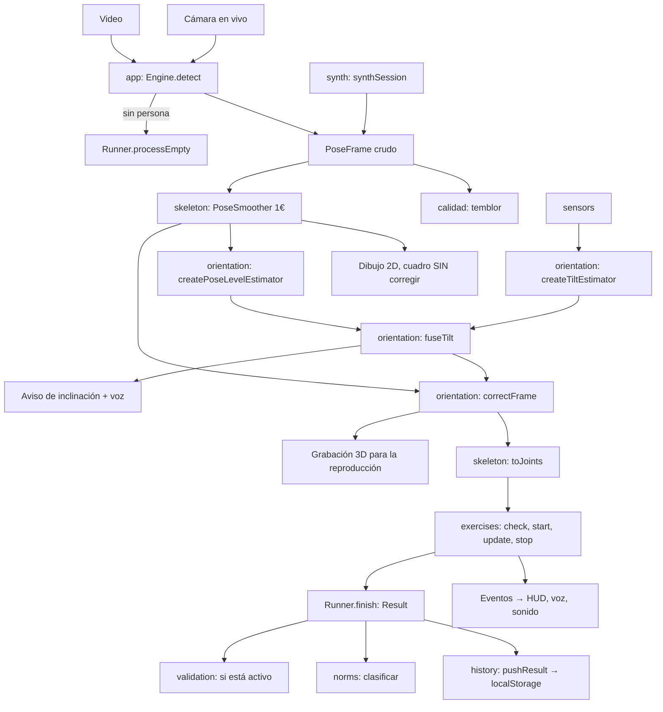

# FitGram — Arquitectura

Estructura del documento tomada de la arquitectura de la v1 de José (`docs/jose-v1/ARQUITECTURA.md`), **reescrita para esta app el 22-nov-2026**. Qué hace el producto: `ALCANCE_MVP.md`; requerimientos: `HISTORIAS_DE_USUARIO.md`; cómo se arma y se prueba: `README.md`.

## 1. Mapa de módulos

Módulos ES en `src/`, uno por responsabilidad. `build.mjs` los pega dentro de `src/index.template.html`, en el lugar de la marca `<!--MODULOS-->`, y escribe un solo `index.html` (en orden de dependencias, sin minificar). `npm test` falla si `index.html` no corresponde a `src/` (`test/construccion.test.mjs`).

**Reglas del build (si no se cumplen, `build.mjs` falla):**
- Las importaciones entre módulos usan solo dos formas, en una línea cada una: `import { a, b } from './x.mjs';` o `import * as X from './x.mjs';`. Nada de importaciones por defecto ni rutas a otras carpetas.
- Cada módulo tiene **un solo** `export { … };`, al final del archivo. Nada de `export function` ni `export const` sueltos (los módulos traídos de la v1 se convirtieron a esta forma).
- El build traduce cada `import` a `const { a } = __mods["x"]` y el `export` a un `return`; por eso el archivo publicado se puede comparar línea por línea con `src/`.
- HTML y CSS viven en `src/index.template.html`; las pantallas nuevas se agregan ahí y su lógica en `app.mjs`.

| Módulo | Responsabilidad | DOM | Pruebas |
|---|---|---|---|
| `norms.mjs` | Baremos (CSEP/ACSM, ACE, Strand 2014), clasificación, percentil de plancha, perfil general. `AGE_RANGE` (18–21) y `coversAge`. | No | Sí |
| `skeleton.mjs` | Mapas de articulaciones (BlazePose 33 → Human3.6M 17), `toJoints`, filtro 1€, dibujo 2D, visor 3D, elevador 3D. | Canvas | Sí |
| `synth.mjs` | Persona sintética determinista (demo y pruebas), con cámara inclinable. | No | Sí |
| `exercises.mjs` | Analizadores: máquina de estados por prueba, repeticiones válidas, avisos de técnica, criterios de término. Huella de las reglas de conteo. | No | Sí |
| `orientation.mjs` | Inclinación del teléfono: sensores → gravedad en la imagen, estimación por postura, fusión, corrección de la pose, textos. **Traído de v1.** | No | Sí |
| `sensors.mjs` | Permiso de movimiento (iOS), eventos `deviceorientation`/`devicemotion`, diagnóstico. **Traído de v1.** | Eventos | e2e |
| `compartir.mjs` | Lo que la persona decide guardar o compartir: arma el archivo del esqueleto (sin imagen, sin fecha exacta) y elige el formato de video que el navegador sabe grabar. La grabación (`Runner.startGrab`/`componer`/`stopGrab` y `Review.grabar`) vive en `app.mjs`. | No | Sí |
| `calidad.mjs` | Temblor de la detección y tiempo sin ver: ¿se puede confiar en esta serie? | No | Sí |
| `history.mjs` | Historial por prueba (hasta 50; el 51 descarta el más antiguo), avance contra el anterior y aviso de no comparables (`noComparable`), ciclo de 4 semanas, migración del formato viejo, borrar una medición (`removeResult`) y CSV personal (`toCSV`). | No | Sí |
| `validation.mjs` | Modo validación: registros app + evaluadores (`newRecord` normaliza todo registro), carga local (`loadRecords`) e importación de respaldos (`mergeRecords`: cuenta los que ya estaban, los que chocan con la misma persona y prueba, y los inválidos), duplicados, resumen de una corrida de la app (`runFromResult`, `runYaUsada`), desglose de motivos (`breakdown`, `classifyRecord`), acuerdo, Bland-Altman, CCI(2,1) con intervalo, CSV, mediciones sin exportar (`unexportedCount`). `SIN_VER_MIN` está copiado de `calidad.mjs` a propósito (los módulos no se importan entre sí). | No | Sí |
| `game.mjs` | Modo juego (prototipo, idea de Elías): recorrido, puertas y puntaje. | No | Sí |
| `camara-errores.mjs` | Qué decir cuando la cámara no abre. | No | Sí |
| `app.mjs` | Todo lo que toca la página: pantallas, cámara, MediaPipe (`Engine`), la prueba en curso (`Runner`), voz y sonido, resultados, perfil, validación, juego, ajustes, service worker. | Sí | e2e |

Dependencias: `app` importa a todos; `sensors` importa `orientation`; el resto no importa nada. No hay ciclos (el build falla si aparece uno).

Archivos fuera de `src/`: `sw.js` (sin conexión), `manifest.webmanifest`, `lib/` y `wasm/` (MediaPipe Tasks Vision), `models/` (`pose_landmarker_full.task` y `_lite.task`), `tools/e2e.py`.

## 2. Flujo de datos por cuadro

Tres fuentes alimentan la misma tubería: cámara en vivo, video (grabado o de la galería) y demostración. La inclinación se estima **antes** de empezar y se **fija** al iniciar la prueba.



Pasos (`Runner.process` en `app.mjs`):
1. **Detección.** `Engine.detect` devuelve un `PoseFrame` o `null`. Sin persona, `processEmpty` igual actualiza la inclinación (los sensores la saben) y deja que el analizador cuente el tiempo sin ver.
2. **Calidad.** El temblor se mide sobre los puntos **sin suavizar**.
3. **Suavizado.** Filtro 1€.
4. **Inclinación (antes de empezar).** El cuadro sin corregir alimenta la estimación por postura; en vivo, los sensores alimentan su estimador. `fuseTilt` combina la última lectura quieta del sensor con la postura. En videos solo hay postura; en la demo el aviso se oculta. Al empezar (`beginActive`) la inclinación se fija; después, si el sensor se aleja más de 5°, se avisa una vez (pantalla y voz) y el resultado queda marcado.
5. **Corrección.** `correctFrame` se llama en cada cuadro y siempre devuelve un cuadro nuevo. Rota la pose (gravedad en +y) solo si la corrección está activada en Ajustes y la inclinación es corregible: |roll| ≤ 30°, y, si se conoce el pitch, |pitch| ≤ 60° (`isCorrectable`); si no, copia los puntos sin rotarlos (`corrected: false`).
6. **Joints → analizador.** Antes de empezar, `check` dice si la posición es válida (y lo dice en voz si el mensaje se mantiene). En vivo hay una cuenta de 10 s y luego hay que mantener la posición 1 s; la plancha arranca cuando su analizador la confirma.
7. **Resultado.** `Runner.finish` arma el `Result` y lo guarda en el historial (salvo demo y modo stand). Si en flexiones o sentadillas no se juzgó ninguna repetición, o el reloj de la plancha no partió, no hay resultado: `notStarted` muestra el motivo y no se guarda nada. La prueba también termina sola si la cámara deja de mandar cuadros (vigilancia de cuadros) o si el detector falla más de 90 veces seguidas. Los motivos de término (`endReason`) son los del analizador más `manual`, `not_visible` y `video_end`.

## 3. Formatos de datos

### PoseFrame (`Engine.detect` en `app.mjs`, o `synth.mjs`)
```js
{ t,                                    // ms, monótono
  lm: [{x, y, z, visibility}, ...33],   // imagen, x e y en [0,1], y hacia abajo, sin espejo
  world: [{x, y, z, visibility}, ...33] | null,  // metros, origen en las caderas
  aspect,                               // ancho / alto
  tilt?, corrected? }                   // solo tras correctFrame
```

### Joints (`skeleton.mjs#toJoints`)
```js
{ j2: { nombre: {x, y, v} },            // x = lm.x * aspect, y = lm.y
  j3: { nombre: {x, y, z, v} } | null,
  t }
```
Un punto ausente queda `{x: NaN, y: NaN, v: 0}`.

### Tilt (`orientation.mjs`)
```js
{ roll, pitch,            // grados; pitch null si solo hay imagen
  down: {x, y, z?},       // gravedad en ejes de la imagen
  source,                 // 'sensor' | 'image' | 'none'
  confidence, still, sideways, correctable, reason?, conflictDeg? }
```
`describeTilt(tilt)` → `{ level: 'ok'|'warn'|'bad', msg }`.

### AnalyzerState (`exercises.mjs`, lo entregan `update` y `stop`)
```js
{ test, phase,            // 'waiting' | 'active' | 'ended'
  value, invalid, cue, events, metrics, visible,
  log: [{ t, valid, reason }], sinVer, endReason }
```

### Result (`Runner.finish` en `app.mjs`; lo guarda `history.mjs`)
```js
{ value, invalid, endReason, mode, date, log,   // log: los primeros 200 eventos
  calidad: { nivel, temblor, ... } | null,
  captura: { fuente, roll, pitch, corregida, movido },   // inclinación (desde 22-nov)
  sinVer, reglas,                               // segundos sin ver; huella de las reglas de conteo
  profile: { age, sex } }
```

### Classification (`norms.mjs#classifyPushups|Squats|Plank`)
```js
{ test, value, unit, band,                         // band: banda de edad del baremo (p. ej. '20-29')
  category: { key, label, index, of },             // posición dentro del baremo
  position, percentile,                            // 0–100; percentil solo en plancha
  table: [{ key, label, min, max, text }],         // filas del baremo
  next, flags,                                     // qué falta para subir; advertencias ('unverified_cut', 'questionable_source', 'extrapolated')
  source: { short, apa, url } }
```

### Registro de validación (`validation.mjs`)
```js
{ id, participant, test, date, app, raters: [n, n, ...], note,
  run: { invalid, counted, endReason, calidad, temblor, sinVer, reglas,
         inclinacion, inclFuente, movido, fecha,
         reasons: { motivo: cantidad } } | null }   // por qué se descartaron repeticiones
```
CSV con `;` y coma decimal (se abre en Excel en Chile); JSON recargable.

### Almacenamiento (`localStorage`)
| Clave | Contenido |
|---|---|
| `fitgram.v0` | Perfil, ajustes e historial personal. |
| `fitgram.validation.v1` | Mediciones de validación (aparte a propósito: «Borrar mis datos» no las toca). |
| `fitgram.validation.exported.v1` | Cuándo se exportó la validación por última vez. |

Toda escritura pasa por `saveStore`, `saveValid` y `saveValidExport` (`app.mjs`), y las tres no hacen nada en modo stand: en una feria no queda ningún dato de los visitantes en el teléfono. Una clave nueva tiene que escribirse a través de una función que respete `S.stand`.

## 4. Cómo hacer…

- **Correr las pruebas:** `npm test` (unitarias) y `python3 tools/e2e.py SALIDA [videos…]` (navegador). Los módulos se importan directamente en las pruebas; `test/_load.mjs` sirve para lo que no es un módulo (`sw.js`, funciones sueltas de `app.mjs`, que no se puede importar en Node porque toca el DOM). `test/construccion.test.mjs` comprueba que `index.html` corresponda a `src/`.
- **Armar:** `npm run build`. Nunca editar `index.html` a mano.
- **Agregar un módulo nuevo:** crearlo en `src/` siguiendo las reglas del build (§1) e importarlo desde `app.mjs` (directa o indirectamente). Un módulo que nadie importa queda fuera de `index.html`: el build solo avisa, y `test/construccion.test.mjs` falla.
- **Agregar una prueba** (que entre es decisión del equipo; la v1 de José tiene dominadas y fondos como ejemplo):
  1. `norms.mjs`: el baremo en `NORMS` y su función de clasificación, que devuelva una `Classification`; prueba de bordes en `test/baremos.test.mjs`.
  2. `exercises.mjs`: el analizador. `createAnalyzer` acepta una lista fija de pruebas (`pushup`, `squat`, `plank`): hay que agregar la nueva ahí y su máquina de estados, con umbrales en `EX_CONFIG`. Si usa funciones de conteo nuevas, sumarlas a `CODIGO_DE_CONTEO` para que entren en la huella de las reglas.
  3. Cambiar `EX_CONFIG` (o `SKELETON_CONFIG`, o el código de conteo) cambia la huella de las reglas: `REGLAS`, que se arma en `app.mjs` con `huellaDe` a partir de esas tres cosas. las mediciones nuevas quedan marcadas como contadas con otras reglas y el modo validación avisa si se mezclan. Es lo esperado.
  4. `orientation.mjs`: su postura de partida en `POSE_REFS`, para estimar la inclinación.
  5. `synth.mjs`: la persona sintética, para la demo y las pruebas automáticas.
  6. `app.mjs`: su ficha en `TESTS`, el lugar en `ORDER`, el dibujo de ubicación (`placementSVG`) y una rama en `classify`: hoy cualquier prueba que no sea flexiones o sentadillas se clasifica como plancha, sin avisar. Revisar también los `if (test === 'plank')` de la pantalla de resultado y de la voz.
  7. `norms.mjs#fitnessProfile`: hoy promedia solo flexiones, sentadillas y plancha; hay que decidir si la nueva prueba entra al índice (decisión del equipo).
  8. Pruebas del analizador con la persona sintética (como en `test/robustez.test.mjs`) y un escenario en `tools/e2e.py`.
- **Cambiar el rango de edad:** `AGE_RANGE` en `src/norms.mjs`. Más allá de 21 hay que cargar baremos para esas edades. (Decisión del equipo.)
- **Cambiar datos guardados sin romper los de antes.** Los campos nuevos se agregan como opcionales: el código que lee un `Result` o un registro de validación tiene que aceptar que falten (por ejemplo, resultados sin `captura`, de antes del 22-nov, o sin `calidad`). Si un cambio no se puede hacer así, se escribe una migración en `history.mjs#migrateStore` (personal) o en `validation.mjs#newRecord` / `normalizeRun` (validación: por ahí pasan tanto la carga local, `loadRecords`, como la importación de respaldos, `mergeRecords`), con su prueba. Ojo: al guardar, `history.mjs#trim` borra el `log` de todos los resultados salvo el más reciente de cada prueba (ahorra espacio), así que el código no puede contar con el `log` de resultados viejos. La exportación personal lleva `schema: 1` (hoy nadie la vuelve a cargar); la de validación no lleva `schema` y se recarga con `mergeRecords`. Si alguna cambia de forma incompatible, conviene agregar o subir `schema` y que la carga distinga las versiones.
- **Publicar una versión con archivos nuevos.** Si se agrega un archivo que la app necesita (tipografía, ícono, modelo), se suma a `SHELL` (código, fuentes, íconos) o `HEAVY` (`.wasm`, `.task`) en `sw.js`. `VERSION` se sube cuando cambian esas listas o la lógica de `sw.js` (así se borran los cachés viejos). Un cambio solo de código no lo necesita: `index.html` no se precarga y va primero a la red. `test/sw.test.mjs` prueba que los modelos estén en `HEAVY` y que `index.html` no se precargue.
- **Probar en el teléfono antes de publicar:** servir en la IP de Tailscale (la cámara en vivo necesita HTTPS; por HTTP se prueba con video).
- **Publicar:** push a `main` de `dief-ysis/fitgram`; GitHub Pages sirve la raíz. El service worker puede mostrar la versión anterior hasta que aparezca «Actualizar».

## 5. Limitaciones conocidas y deuda técnica

### Deuda técnica
- **`app.mjs` tiene ~2.800 líneas.** Mezcla pantallas, cámara, `Engine`, `Runner`, validación, juego y ajustes. La arquitectura de la v1 de José lo partía en `store`, `engine`, `ui`, `runner`, `screens` y `app`; es la dirección a seguir, de a un módulo y con `tools/e2e.py` como red.
- `skeleton.mjs` (~1.300 líneas) mezcla filtros, dibujo 2D, visor 3D y elevadores.
- Estado global en el objeto `S` de `app.mjs`.
- La capa DOM solo se prueba con `tools/e2e.py`. En Chrome sin pantalla los sensores llegan muy lento mientras corre MediaPipe: la inclinación por sensores se verifica en el teléfono.

### Limitaciones de producto
- **Nada probado sistemáticamente en teléfonos reales** (cuadros por segundo, batería, calor, sensores, permisos de iOS).
- **Inclinación solo por imagen** menos precisa que con sensor (videos subidos).
- **Sentadillas (ACE):** origen dudoso de la tabla; se advierte.
- **Cortes de flexiones sin verificar** en fuente primaria; se advierte.
- **Perfil general:** índice exploratorio, no validado.
- **Sin backend:** sin cuentas ni base central. Los resultados personales viven en el teléfono y se exportan a mano (CSV/JSON desde el perfil).
- **VideoPose3D** no incluido (licencia no comercial).
