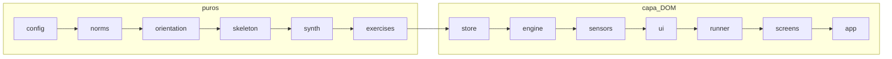
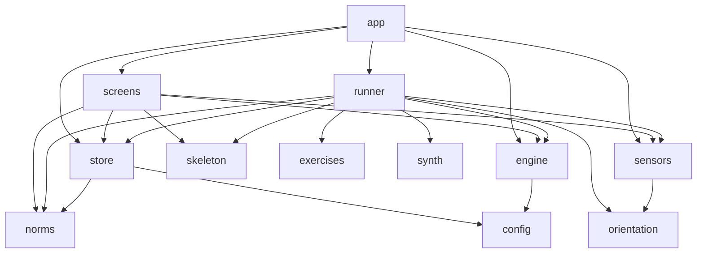
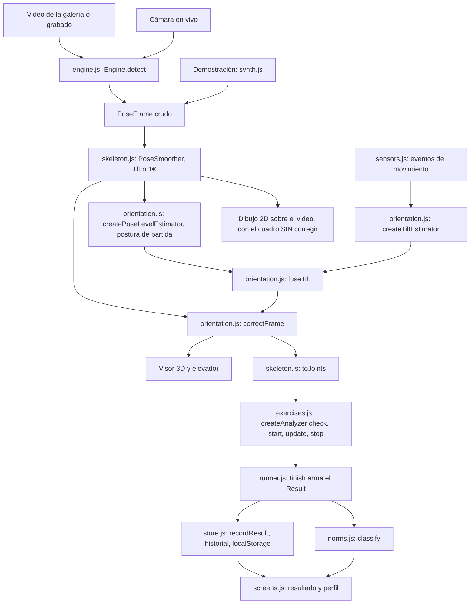

# FitGram v1 — Arquitectura

Guía para David (desarrollo). Todo lo de aquí sale del código de `src/` y de los JSDoc de cada módulo; si algo cambia en el código, este documento se actualiza en el mismo cambio. Complementa a `CONTRACT.md` (reglas entre módulos), `README.md` (uso) y `ALCANCE_MVP.md` / `HISTORIAS_DE_USUARIO.md` (producto).

Estado al 13 de noviembre de 2026: 13 módulos en `src/`, 263 pruebas automáticas (`node --test test/*.test.mjs`) pasando en Node 22. Nada se ha probado todavía en teléfonos reales (ver sección 5).

## 1. Mapa de módulos

La app es una sola página web. `build.mjs` concatena los módulos (en el orden de `ORDER`) dentro de un único `<script type="module">`. Un módulo solo importa de módulos anteriores, así que no hay ciclos (el build falla si los hay). Los seis primeros son **puros** (sin DOM, corren igual en Node y en el navegador); el resto es la **capa DOM**.

| # | Módulo | Capa | Responsabilidad |
|---|---|---|---|
| 1 | `config.js` | pura | Constantes de la app: identidad y claves de almacenamiento (`APP`), público (`AUDIENCE`), entorno (`HOST`), versión y URLs de MediaPipe, orden y grupos de pruebas (`TEST_ORDER`, `TEST_GROUPS`), y textos y dibujos de cada prueba (`TESTS`). |
| 2 | `norms.js` | pura | Baremos y clasificación por edad y sexo (`classify`, `bandFor`, `fitnessProfile`). Datos congelados con fuentes, protocolo y advertencias. |
| 3 | `orientation.js` | pura | Inclinación del teléfono: sensores a gravedad en la imagen, estimación por postura de partida, fusión de ambas y corrección de la pose (`correctFrame`). |
| 4 | `skeleton.js` | pura | Puntos del cuerpo (BlazePose 33, Human3.6M 17, COCO 17), `toJoints`, filtro 1€ (`PoseSmoother`), dibujo 2D, visor 3D (`View3D`) y «elevadores» 2D a 3D (`createLifter`). |
| 5 | `synth.js` | pura | Persona sintética determinista (demo y pruebas), con cámara inclinable (`cameraRoll`, `cameraPitch`). |
| 6 | `exercises.js` | pura | Un analizador por prueba: cuenta repeticiones válidas o segundos, avisa técnica y decide cuándo termina (`createAnalyzer`). |
| 7 | `store.js` | DOM | Estado compartido `S`, guardado en `localStorage`, migración desde v0, historial, exportación CSV y JSON, registro anónimo. |
| 8 | `engine.js` | DOM | MediaPipe Pose Landmarker en el navegador: descarga del modelo, carga, detección (`Engine.detect`) y recuperación de errores. |
| 9 | `sensors.js` | DOM | Permiso de movimiento en iOS, eventos `deviceorientation`/`devicemotion` y diagnóstico de sensores; alimenta al estimador de inclinación. |
| 10 | `ui.js` | DOM | Utilidades de pantalla: elemento por id, formato (coma decimal, m:ss, grados), voz, sonidos y pantalla encendida. |
| 11 | `runner.js` | DOM | La prueba en curso: fuente de cuadros (cámara, video o demo), tubería cuadro a cuadro, inclinación, HUD, avisos y construcción del resultado. |
| 12 | `screens.js` | DOM | Pantallas: datos, evaluación, antes de la prueba, resultado, perfil y ajustes; une los resultados guardados con los baremos. |
| 13 | `app.js` | DOM | Arranque: carga el estado, conecta `Runner.hooks` con las pantallas, enlaza los botones y muestra la primera pantalla. Expone `window.FITGRAM` (la usa `tools/e2e.py`; no cambiar su forma). |

Otros archivos: `src/index.template.html` (estructura y estilos), `build.mjs` (arma `dist/`), `test/*.test.mjs` (pruebas, un archivo por módulo más pruebas de integración), `tools/e2e.py` (prueba completa en Chrome sin pantalla, con cámara y sensores simulados), `tools/package.py` (empaqueta `dist/` y las fuentes en un zip) y `tools/export_videopose3d_onnx.py` (pendiente).

### Orden de dependencias



Esa es la regla (cada módulo solo puede importar de los anteriores). Las dependencias reales son más pocas; las principales:



`exercises.js` no importa nada (recibe `Joints` ya listos). `synth.js` y `exercises.js` son independientes entre sí; las pruebas los conectan.

## 2. Flujo de datos por cuadro

Tres fuentes de cuadros alimentan la misma tubería: la cámara en vivo, un video (grabado o de la galería) y la demostración con persona sintética. La inclinación se decide **antes** de empezar y se **fija** al iniciar la prueba.



Pasos, en palabras (`Runner.process` en `runner.js`):
1. **Detección.** `Engine.detect(video, t, aspect)` devuelve un `PoseFrame` crudo (o `null`). En la demostración, los cuadros vienen de `synthSession`.
2. **Suavizado.** `PoseSmoother.smooth` aplica el filtro 1€ a los puntos.
3. **Dibujo.** `drawSkeleton2D` dibuja con el cuadro suavizado **sin corregir**, para que coincida con la imagen del video.
4. **Inclinación (antes de empezar).** El cuadro sin corregir alimenta a `createPoseLevelEstimator` (postura de partida). Los sensores alimentan a `createTiltEstimator` mediante `sensors.js`. `fuseTilt` combina la lectura quieta del sensor con la estimación por postura. En videos y demos solo existe la estimación por postura. Al comenzar la prueba, `lockTilt` fija la inclinación; después, `checkMoved` avisa si el teléfono se mueve (deriva de más de `driftDeg` = 5° o sin quietud por `unstillMs` = 1 s).
5. **Corrección.** `correctFrame(frame, tilt)` devuelve un cuadro nuevo con la gravedad en +y (solo si `settings.tiltCorrection` está activado y la inclinación es corregible).
6. **Joints.** `toJoints` convierte el cuadro corregido en `Joints` (`j2` en unidades de imagen corregidas por aspecto, `j3` en metros).
7. **Analizador.** `check` (posición de partida), `update` (por cuadro) y `stop`. La fase `arming` espera mantener la posición válida `armHoldMs` = 1 s; en vivo hay una cuenta de 10 s antes (`countdownLiveS`). La plancha arranca su reloj cuando el propio analizador confirma la posición.
8. **Resultado.** Cuando el analizador termina, `Runner.finish` arma el `Result` (con `capture` de la inclinación), lo guarda con `recordResult` (excepto las demostraciones) y pide a `screens.js` que lo muestre. Allí, `classify` de `norms.js` entrega la `Classification`.

## 3. Formatos de datos

Los tipos están definidos en el JSDoc del código; aquí se resumen los campos reales.

### PoseFrame (lo produce `Engine.detect` o `synth.js`)

```js
{ t,            // ms, monótono
  lm: [{x, y, z, visibility}, ...33],     // imagen cruda, x e y en [0,1], y hacia abajo, sin espejo
  world: [{x, y, z, visibility}, ...33],  // metros, origen en el centro de las caderas, ejes de la cámara; puede ser null
  aspect,       // ancho / alto de la imagen analizada
  tilt?, corrected? }   // solo en cuadros pasados por orientation.correctFrame
```

### Joints (`skeleton.js#toJoints`)

```js
{ j2: { nombre: {x, y, v} },          // x = lm.x * aspect, y = lm.y (y hacia abajo = gravedad)
  j3: { nombre: {x, y, z, v} } | null, // metros, desde frame.world
  t }
```
25 nombres: `nose, l_ear, r_ear, mouth_l, mouth_r, l_shoulder, r_shoulder, l_elbow, r_elbow, l_wrist, r_wrist, l_index, r_index, l_pinky, r_pinky, l_hip, r_hip, l_knee, r_knee, l_ankle, r_ankle, l_heel, r_heel, l_foot, r_foot`. Un punto ausente queda como `{x: NaN, y: NaN, v: 0}`.

### Tilt (`orientation.js`)

```js
{ roll,         // grados; + = cámara girada en sentido horario vista desde atrás
  pitch,        // grados; + = mira sobre el horizonte; null si solo hay imagen
  down: {x, y, z?},   // gravedad unitaria en ejes de la imagen
  source,       // 'sensor' | 'image' | 'none'
  confidence,   // 0 a 1
  still,        // true | false | null
  sideways,     // |roll| > sidewaysDeg: imagen girada
  correctable,  // true si se puede corregir automáticamente (|roll| <= maxAutoDeg y cámara no apuntando al suelo o techo)
  reason?, conflictDeg? }   // la fusión agrega la razón y la diferencia sensor vs postura
```
`describeTilt(tilt)` devuelve `{ level: 'ok'|'warn'|'bad', msg }` en español para la interfaz.

### AnalyzerState (`exercises.js`, lo entrega `update` y `stop`)

```js
{ test, phase,            // 'waiting' | 'active' | 'ended'
  value, invalid,         // repeticiones válidas (o segundos en plancha) y no válidas
  cue,                    // null | { level: 'good'|'warn'|'bad', msg }
  events,                 // eventos nuevos desde la llamada anterior: 'rep' | 'invalid' | 'cue' | 'start' | 'end'
  metrics: { elbow, knee, hip, line, torso },   // grados para el HUD (null si no se sabe)
  visible,
  log: [{ t, valid, reason }],
  endReason }             // null | 'manual' | 'technique' | 'pause' | 'position_lost' | 'not_visible'
```
El runner agrega `'video_end'` como motivo cuando se acaba el video. En dominadas y fondos, `position_lost` significa soltar la barra o apoyar los pies.

### Classification (`norms.js#classify`)

```js
{ test, value, unit,        // 'rep' | 's'
  band,                     // etiqueta de la banda o tabla usada
  category: { key, label, index, of } | null,   // null cuando no hay baremo (fondos en mujeres)
  position,                 // 0 a 100, escala común del perfil; null sin baremo
  percentile,               // plancha, fondos (estimado); null si no aplica
  table: [{ key, label, min, max, text }],      // de menor a mayor; [] sin baremo
  next: { label, needed } | null,
  flags: [...],             // 'unverified_cut' | 'questionable_source' | 'extrapolated' | 'estimated_norm' |
                            // 'trained_sample' | 'military_standard' | 'age_outside_sample' | 'no_norm'
  references: [{ key, label, text }],
  source: { short, apa, url }, sources: [...] }
```
Edad fuera de 18 a 30, o sexo distinto de M/F, lanza `RangeError` con mensaje en español. `NORMS_VERSION` (hoy `'2026-11-12'`) se guarda en cada resultado.

`fitnessProfile(parts)` entrega `{ position, label, parts, note }`: promedio de las posiciones disponibles; etiquetas por tramos de 20 (Muy bajo, Bajo, Medio, Alto, Muy alto).

### Result guardado (`store.js`, typedef `Result`)

```js
{ test, value,                // repeticiones, o segundos con 0,1 s
  invalid, endReason,
  mode,                       // 'live' | 'video' (las demostraciones no se guardan)
  date,                       // ISO
  log: [{t, valid, reason}],  // máximo LOG_MAX = 200
  profile: { age, sex, athlete },   // perfil al momento de la prueba
  variant,                    // 'toes' | 'knees' (flexiones), null en las demás
  normsVersion, appVersion,
  capture: { tilt: { source, roll, pitch, confidence, reason, conflictDeg? },
             corrected, correction, moved,
             sensors: { orientation, accelerometer, gyroscope } | null } | null }
```
Documento completo en `localStorage` bajo `fitgram.v1` (esquema 1): `{ schema: 1, profile: { age, sex, athlete }, results: { [test]: Result }, history: Result[] (máximo 300, el más nuevo al final), settings }`. Ajustes: `voice, angles, model ('full'|'lite'), facing ('user'|'environment'), show3d, tiltCorrection`. Los datos de `fitgram.v0` se migran una vez y la clave antigua queda intacta.

### Exportación

- **JSON** (`exportJSON`): `{ app, appVersion, exportedAt, ...documento guardado }`. Archivo `fitgram-AAAA-MM-DD.json`.
- **CSV** (`exportCSV`): separador `;`, coma decimal, UTF-8 con BOM, fin de línea CRLF; una fila por resultado del historial, del más antiguo al más nuevo. Columnas, en orden: `Fecha; Prueba; Código; Valor; Unidad; No válidas; Categoría; Banda del baremo; Percentil; Edad; Sexo; Compite; Variante; Modo; Motivo de término; Inclinación (fuente); Inclinación (°); Corregida; Teléfono movido; Versión del baremo; Versión de la app`. La categoría, la banda y el percentil se recalculan con los baremos de esta versión y el perfil guardado en cada resultado.

### Registro anónimo (`store.js#toAnonymousRecord`) — para la futura base central

Solo existe la función y su formato; **v1 no envía nada**.

```js
{ v: 1, test, value, unit, sex,
  ageBand,        // banda de 5 años: '15–19', '20–24', '25–29', '30–34'...
  normBand,       // banda del baremo usada
  athlete, variant, mode,
  month,          // 'AAAA-MM' (UTC)
  tiltSource, corrected, appVersion, normsVersion }
```
No incluye nombre, identificador, video, edad exacta ni fecha exacta.

## 4. Cómo hacer…

### Cambiar el rango de edad
El público está en `AUDIENCE` de `src/config.js` (`minAge`, `maxAge`, `label`). La pantalla de datos, los mensajes y la validación del perfil (`normalizeProfile`) lo usan. `test/config.test.mjs` falla si `AUDIENCE` queda fuera de `NORMS_AGE` (`src/norms.js`, hoy 18 a 30). Para pasar de 30 años, primero hay que cargar los baremos de esas edades en `norms.js` y ampliar `NORMS_AGE`; solo cambiar `AUDIENCE` no basta.

### Agregar una prueba nueva
1. **`src/config.js`**: agregar el id a `TEST_ORDER`, ponerlo en exactamente un grupo de `TEST_GROUPS`, y definir su ficha en `TESTS` (nombre, unidad `'rep'` o `'s'`, texto de cómo se mide, pasos de colocación, `landscape`, equipo, dibujo `figure`, celdas de ángulos `cells` y ángulo dibujado `angle`).
2. **`src/norms.js`**: agregar los datos en `NORMS` (protocolo, categorías, tablas, fuentes, advertencias), una función `classifyXxx` y el caso en `classify`, `bandFor` y en el orden de `fitnessProfile` (`PROFILE_ORDER`). Sin baremo para algún grupo, devolver `category: null` y la bandera `no_norm`.
3. **`src/exercises.js`**: agregar el analizador (`REP_SPECS` para pruebas de repeticiones, o una máquina propia como la plancha) y que `createAnalyzer` lo reconozca. Si necesita puntos nuevos del cuerpo, agregarlos a `JOINT_NAMES` en `skeleton.js`.
4. **`src/synth.js`**: agregar el movimiento sintético para `synthSession`, con el resultado esperado en `meta`.
5. **`src/runner.js`**: agregar un escenario en `DEMO_SCENARIOS` para la demostración.
6. **Textos de término** en `END_TEXT` (`config.js`) si el motivo de término es nuevo.
7. **Pruebas** en `test/`: baremos (valores en los bordes de cada banda), analizador con sesiones sintéticas (válidas, inválidas, con cámara inclinada) y exportación.
8. Actualizar `CONTRACT.md` (tabla de pruebas), `README.md` y las historias de usuario.

Sin ciclos: respetar el orden de `ORDER` y las reglas de `CONTRACT.md` (exportaciones en línea, importaciones con nombre, sin `export default`).

### Correr las pruebas
```
node --test test/*.test.mjs
```
(Node 22 no acepta una carpeta como argumento.) Solo se usan `node:test` y `node:assert/strict`. Hay una prueba de integración de la inclinación (`orientation.integration.test.mjs`) que une `synth`, `orientation` y `exercises`. La prueba completa en navegador es aparte: `python3 tools/e2e.py SALIDA MEDIOS` (Playwright + Chrome, cámara y sensores simulados; `MEDIOS` debe tener `runner.y4m`, `runner.mp4`, `runner8.mp4` y `empty.mp4`).

### Armar el build
```
node build.mjs
```
Necesita la carpeta `assets/` (modelos `pose_landmarker_full.task` y `pose_landmarker_lite.task`, el `.wasm` y la librería de MediaPipe 1.1.0). Genera `dist/web/` (documento completo, para cualquier hosting HTTPS) y `dist/artifact/` (fragmento para un artefacto de Claude). Las variables de entorno `FITGRAM_SRC`, `FITGRAM_DIST` y `FITGRAM_ASSETS` cambian las carpetas. La copia de MediaPipe de `dist/web/lib` se parchea para desactivar el envío de estadísticas de uso; el build falla si no encuentra el código a parchear. `python3 tools/package.py` empaqueta `dist/web` y las fuentes en un zip.

### Publicar en GitHub Pages
1. Correr `node build.mjs`.
2. Crear un repositorio (por ejemplo `fitgram`) y subir el contenido de `dist/web/` a la raíz (incluidas las carpetas `models/`, `wasm/` y `lib/`).
3. En el repositorio: Settings, Pages, Deploy from a branch, `main` / `(root)`.
4. Abrir `https://USUARIO.github.io/fitgram/` en el teléfono y aceptar los permisos de cámara y de movimiento.

La cámara y los sensores solo funcionan en HTTPS (o en `localhost`: `python3 -m http.server 8000` dentro de `dist/web/`). Los modelos pesan varios MB: la primera carga es lenta.

### Publicar la variante para artefacto de Claude
`node build.mjs` deja `dist/artifact/index.html` (fragmento sin `<html>`, `<head>` ni `<body>`), con MediaPipe cargado desde jsDelivr y los modelos envueltos como `models/*.json` (base64), porque el visor de artefactos no sirve archivos `.task`. Se publica con la herramienta de artefactos, pasando `dist/artifact/index.html` como página y `models/` y `wasm/` como archivos de apoyo. En el visor **no** hay cámara en vivo ni sensores de movimiento (la app lo dice): solo video grabado o subido y demostración, con la inclinación estimada por la postura. Para subir una versión nueva, publicar de nuevo el mismo archivo para conservar el enlace.

## 5. Limitaciones conocidas y deuda técnica

**Deuda técnica**
- **`runner.js` tiene unas 1.000 líneas** (1.007). Mezcla fuente de cuadros (cámara, video, demo), máquina de fases, inclinación, HUD, voz y construcción del resultado. Conviene partirlo (por ejemplo, fuentes de cuadros, inclinación y HUD) siguiendo la idea de David de «una responsabilidad por archivo». Hay que respetar el orden de `ORDER`.
- `skeleton.js` (1.314 líneas) también es grande: mezcla filtros, dibujo 2D, visor 3D y elevadores.
- Todo el estado de la capa DOM está en el objeto global `S` (`store.js`); es simple, pero acopla los módulos.
- No hay pruebas automáticas de la capa DOM (`runner`, `screens`); solo la prueba de navegador `tools/e2e.py`, que corre aparte.

**Limitaciones de producto y técnicas**
- **Nada probado en teléfonos reales.** Las pruebas usan persona sintética y la prueba en Chrome sin pantalla. Sin medir: cuadros por segundo en gama media, batería, calor, permisos en iOS Safari 16.4 y comportamiento de los sensores reales.
- **No detecta la barra ni el suelo.** Dominadas y fondos usan la línea de las manos como barra; el apoyo de los pies y la suelta de la barra se infieren de la pose. Una barra fuera de cuadro o mal ubicada se nota solo por sus efectos.
- **La inclinación estimada solo por imagen es menos precisa que la del sensor.** Es el único caso en videos y demostraciones. La app lo informa (`source: 'image'`, con su confianza) y avisa si sensor y postura no coinciden.
- **Baremo de sentadillas (ACE):** el origen de la tabla es dudoso; la app lo marca con `questionable_source`.
- **Fondos en mujeres:** no hay baremo publicado; se guarda la marca sin categoría (`no_norm`).
- **Perfil general:** es un promedio exploratorio de posiciones de baremos distintos, no un puntaje validado.
- **Sin backend.** No hay cuentas, ni base de datos central, ni envío de nada; `toAnonymousRecord` es solo el formato. Cambiar de teléfono se resuelve con la exportación JSON, y no hay importación.
- **Sin modo sin conexión formal.** No hay `service worker`: tras la primera carga, la app depende de la caché del navegador. Pendiente (HU-46).
- **VideoPose3D (3D de fase 2):** `createLifter('videopose3d')` existe, pero faltan los pesos exportados (`tools/export_videopose3d_onnx.py`); son CC BY-NC 4.0 (uso no comercial) y fueron entrenados con Human3.6M, que no tiene ejercicios en el suelo.
- **Modelo y datos en el artefacto:** el visor de artefactos no da cámara ni sensores, y el sitio de MediaPipe se carga desde jsDelivr.
- **Historial acotado** a 300 resultados (`HISTORY_MAX`) y a 200 eventos por resultado (`LOG_MAX`); `localStorage` puede no estar disponible (modo privado): la app sigue funcionando en memoria, sin guardar.
